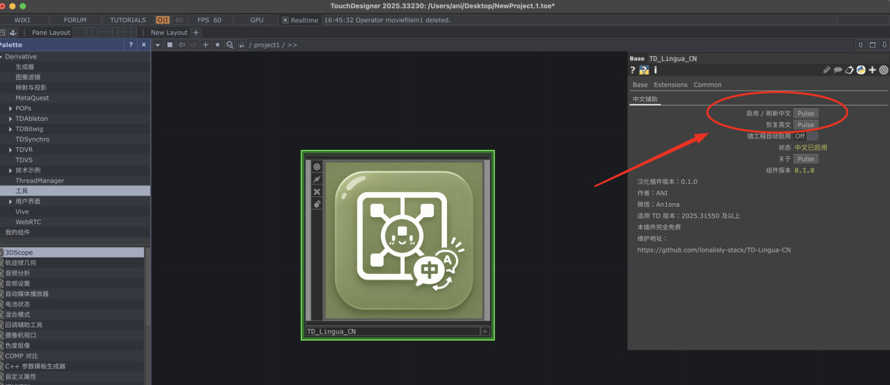
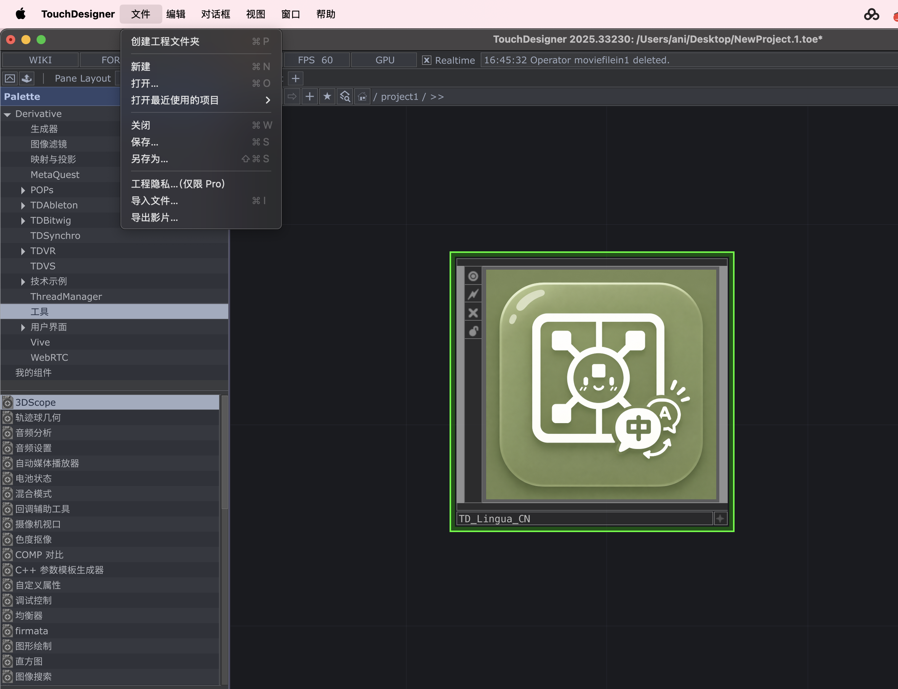
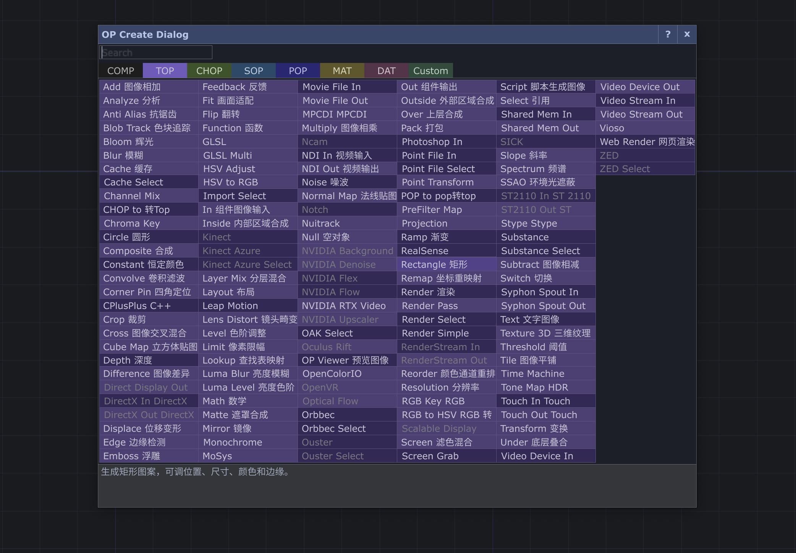
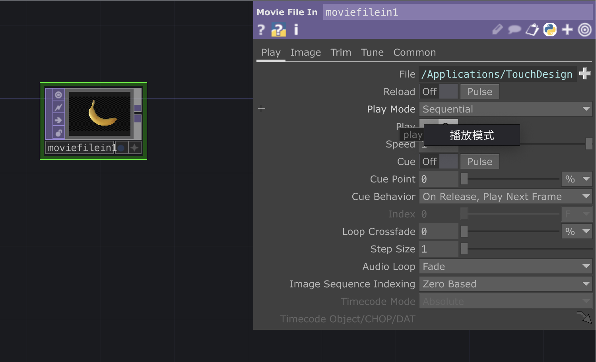
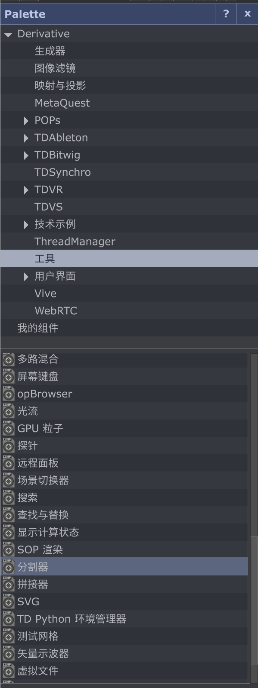

TouchDesigner Global Chinese Localization Plugin/Touchdesigner全局中文汉化插件
 
 
 
 

TD Lingua CN - TouchDesigner 全局中文界面辅助插件

 
 
本工具是基于Python构建的第三方辅助插件，为 TouchDesigner 提供中文辅助显示。

英文标识、内部名称与原生操作逻辑一律保留，不妨碍阅读官方文档与工程协作。

   
 

功能：
 
Main Menu　顶部菜单及下拉命令中文化，保留快捷键与启用/禁用状态。

OP Creator　元件创建窗口中英对照。

OP Descriptions　元件功能说明中文化，辅助理解元件用途与工作原理。

Parameters　参数名称悬停中文提示，根据元件类型进行精准匹配。

Palette　组件库分类与组件名称中文化，保留原有层级与拖放功能。

Auto Start　支持随 TouchDesigner 工程自动启用中文辅助，无需每次手动启动。

   
 
随时切换：一键启用中文，一键恢复英文，适合日常使用与学习软件功能两种场景。
 
   

安装 & 使用
 
    1.    在 Releases 下载最新 .tox

    2.    将 .tox 拖入 TouchDesigner 工程

    3.    选中插件，在参数面板点击 启用 / 刷新中文

    4.    需要英文时点击 恢复英文（卸载或替换插件前请先恢复）
  

### 菜单栏：

### OP面板：

### 参数面板悬浮翻译：

### Palette面板：

  

兼容性
 
版本    TouchDesigner 2025.31550及以上版
系统    Windows / macOS

   
 
已知限制
 
    •    各模块覆盖程度不同，部分参数尚无翻译
    •    参数悬停提示 ≠ 参数下拉选项中文化，后者暂未支持
    •    品牌名、协议名等专有名称保留英文
    •    中文仅作辅助，不替代官方文档，也不改变任何计算逻辑或工程数据
 
   
  
  
支持 🌱
 
⭐ Star 让更多人找到它　·　🐛 发现问题请提 Issue　·　🔗 欢迎分享

 
 
许可 🌸
 
免费使用，禁止转售。

作者

ANI · Liroannis@gmail.com
